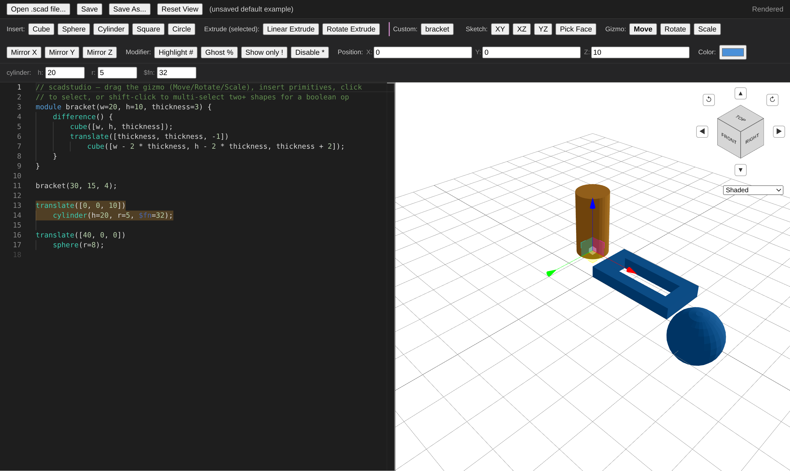
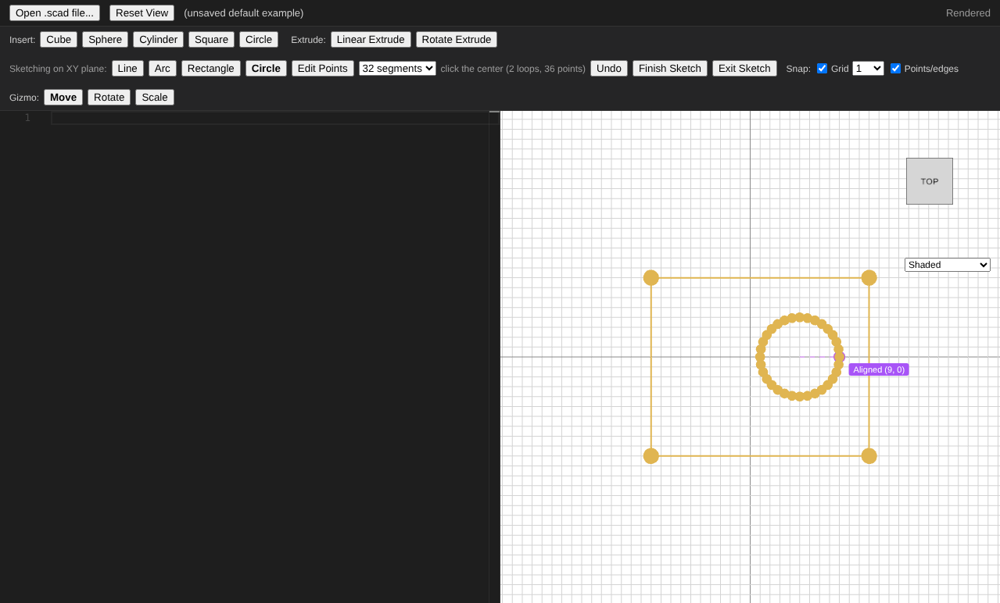
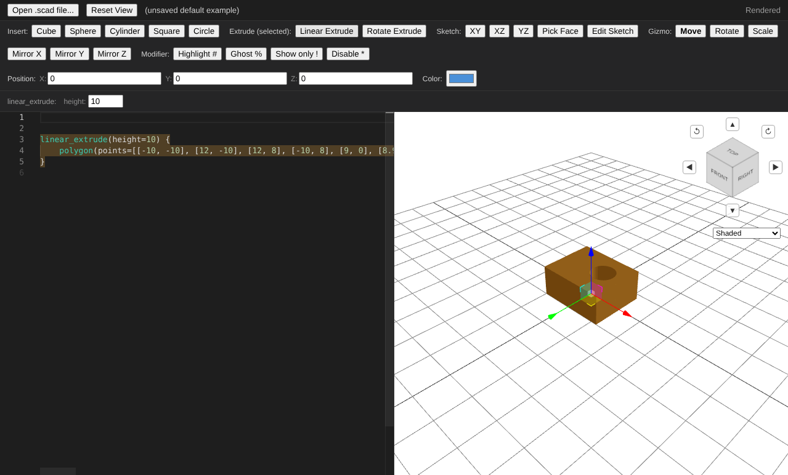
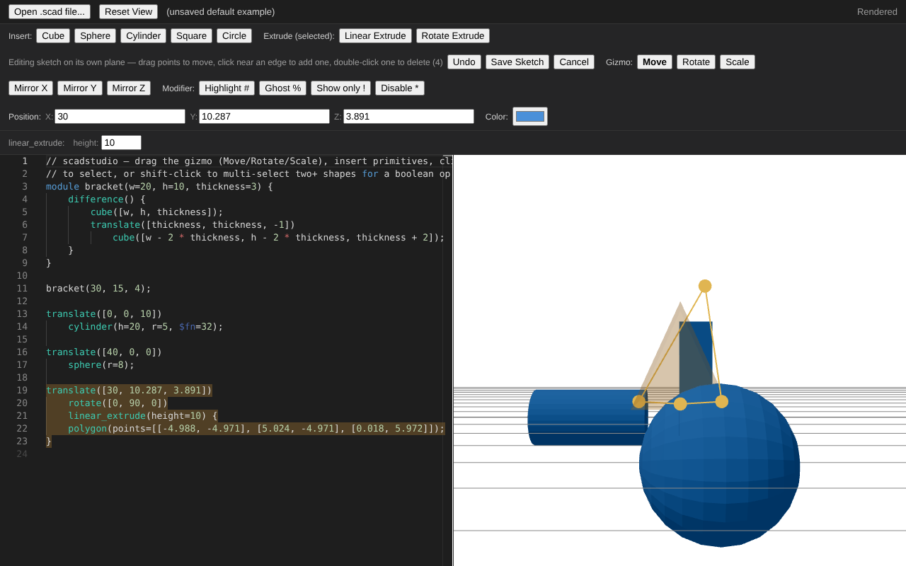
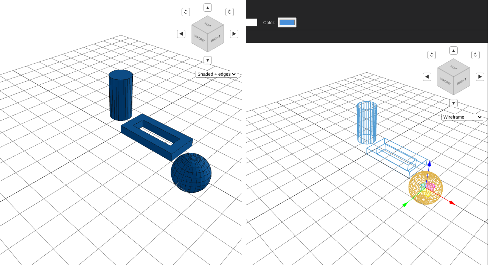

<p align="center">
  
</p>

<h1 align="center">ScadStudio</h1>

<p align="center"><strong>Your model is the source code.</strong></p>

<p align="center">
  <a href="https://github.com/TheSingularis/scadstudio/actions/workflows/tests.yml"></a>
  <a href="https://github.com/TheSingularis/scadstudio/actions/workflows/build-desktop.yml"></a>
  <a href="https://github.com/TheSingularis/scadstudio/releases"></a>
  <a href="LICENSE"></a>
</p>

ScadStudio is a desktop CAD editor for [OpenSCAD](https://openscad.org). You click, drag and sketch parts in a 3D viewport, and every change is written back into your `.scad` file as plain, readable OpenSCAD. There is no project format of its own: the file you save is the same file you can open in OpenSCAD, edit by hand, or keep in git.



> **Beta.** ScadStudio is an early beta (current release: [beta-v0.1.1](https://github.com/TheSingularis/scadstudio/releases/tag/beta-v0.1.1)). Expect rough edges, and keep your files in version control.

## Why ScadStudio

- **Your file stays yours.** Visual edits change only the numbers and lines they are about. Comments, formatting and the rest of your code are left alone.
- **Code and model side by side.** Type in the editor and the model re-renders. Click a part in the viewport and its source is highlighted, and the other way round.
- **Real OpenSCAD geometry.** Rendering uses the OpenSCAD engine itself, compiled to WebAssembly with the fast Manifold backend, so what you see is what OpenSCAD produces.

## Features

What is in the current beta:

- **Editor and live preview.** A code editor with OpenSCAD highlighting next to a 3D viewport that re-renders as you type. A syntax error only affects the statement it is in.
- **Select in either direction.** Click a part to highlight its source, or put the cursor in the source to select the part. Shift-click or Ctrl-click to select several.
- **Move, rotate, scale.** Drag the gizmo or type into the Position fields. Mirror X/Y/Z, a color picker, and a parameter panel for the selected call (for example a cylinder's `h`, `r` and `$fn`).
- **Insert shapes.** Cube, Sphere, Cylinder, Square and Circle from the toolbar.
- **Booleans and modifiers.** Union, Difference and Intersection of the selected shapes, and the OpenSCAD modifiers `#` (highlight), `%` (ghost), `!` (show only) and `*` (disable).
- **Extrusions.** Linear Extrude and Rotate Extrude, either as a new shape or wrapped around a selected 2D shape.
- **Sketch mode.** Sketch on the XY, XZ or YZ plane, or on a flat face of a part. Draw with Line, Arc (3-point), Rectangle and Circle; close several loops to make holes. The sketch is written as one `polygon(points, paths)`. Points snap to other points, midpoints, edges, the grid and horizontal or vertical alignment.
- **Edit sketches later.** Reopen a placed sketch on its plane, drag points, click an edge to add a point, or double-click to remove one. Offset wraps a sketch in `offset(r=...)`.
- **Navigation.** A nav cube to snap to any face, edge or corner view, arrows to turn the view in 90° steps, and Shaded, Shaded with edges, or Wireframe display. Z is up, as in OpenSCAD.
- **Files.** Open, Save and Save As (Ctrl+S, Ctrl+Shift+S), an unsaved-changes marker, and undo (Ctrl+Z) across both typed and visual edits. `use <...>` and `include <...>` resolve the way desktop OpenSCAD resolves them.

### Screenshots

| Sketch mode | Extruded sketch with a hole |
| --- | --- |
|  |  |
| **Sketching on a part's face** | **Nav cube and display modes** |
|  |  |

## Download

Builds are on the [Releases page](https://github.com/TheSingularis/scadstudio/releases). All releases are pre-releases for now.

- **Linux:** download `scadstudio-<version>-x86_64.AppImage`, make it executable (`chmod +x scadstudio-*.AppImage`) and run it.
- **Windows:** download `scadstudio-<version>-x64.exe` and run it; nothing is installed. The exe is not code-signed yet, so Windows SmartScreen will warn about an unrecognized publisher. Choose **More info**, then **Run anyway**.
- **macOS:** there is no packaged build yet. You can run it from source (below).

## Run from source

You need [Node.js](https://nodejs.org) 22 and npm.

```sh
git clone https://github.com/TheSingularis/scadstudio.git
cd scadstudio
npm ci
cd apps/desktop
npm run dev          # start the app with hot reload
npm run build        # or build a production bundle into apps/desktop/out
```

`npm run package:linux` and `npm run package:win` build the AppImage and the portable exe. On a Linux machine with no display, see the headless notes in [TESTING.md](TESTING.md).

## Tests

Unit, integration, real-world corpus (MCAD, OpenSCAD's examples and BOSL2) and Electron end-to-end tests run on every pull request.

```sh
npm test                                   # unit + integration
npm run test:e2e -w @scadstudio/desktop    # builds the app and drives it with Playwright
```

[TESTING.md](TESTING.md) covers every suite, how to run them headless, and how known bugs are tracked as expected failures.

## Known limitations

- `text()` does not render yet, because the bundled engine has no fonts (planned for M15).
- Selecting and dragging works on top-level statements; parts nested inside a boolean or module can't be picked on their own yet (M9).

## Roadmap

ScadStudio is built in milestones; [PLAN.md](PLAN.md) has the full plan and build notes. Next up, in order:

1. **M8: Custom module toolbar.** Every `module` in your file and its `use`d libraries becomes a toolbar tool, with parameter fields inferred from the defaults. (In progress.)
2. **M9: Nested selection.** Click into a boolean, extrusion or module to edit what is inside, with a breadcrumb back out.
3. **M15: `text()` and fonts.**
4. **M11: Directional constraints.** Distances, offsets, alignment and spacing written as plain SCAD variables.
5. **M13: Fillets and chamfers** through the [BOSL2](https://github.com/BelfrySCAD/BOSL2) library.
6. **M10: Polish.** Undo grouping, error UX, external file changes, and the UX backlog.

Later: solver-based sketch constraints (M12) and customizable keybinds (M14).

## How it works

- **Parsing:** [tree-sitter](https://tree-sitter.github.io) with an OpenSCAD grammar turns the source into a syntax tree that keeps every byte, comments and whitespace included.
- **Editing:** a visual edit becomes a small text patch on the exact range it affects, then the file is re-parsed. The text is always the source of truth.
- **Rendering:** [openscad-wasm](https://github.com/openscad/openscad-wasm) with the Manifold backend renders each top-level statement to a mesh, shown with [three.js](https://threejs.org).
- **App:** Electron, React and TypeScript, with the [Monaco](https://microsoft.github.io/monaco-editor/) editor.

## Contributing

Bug reports with a small `.scad` file that shows the problem are the most helpful thing right now. See [CONTRIBUTING.md](CONTRIBUTING.md) for setup and guidelines, and the [Code of Conduct](CODE_OF_CONDUCT.md). Report security problems privately as described in [SECURITY.md](SECURITY.md).

## License

ScadStudio is licensed under the GNU General Public License, version 3 or (at your option) any later version (GPL-3.0-or-later); see [LICENSE](LICENSE). The app bundles the OpenSCAD engine (openscad-wasm, GPL), whose WebAssembly build includes GPLv3+ components such as CGAL, so distributed builds are covered by GPLv3 terms.

ScadStudio is an independent project and is not affiliated with the OpenSCAD project.
